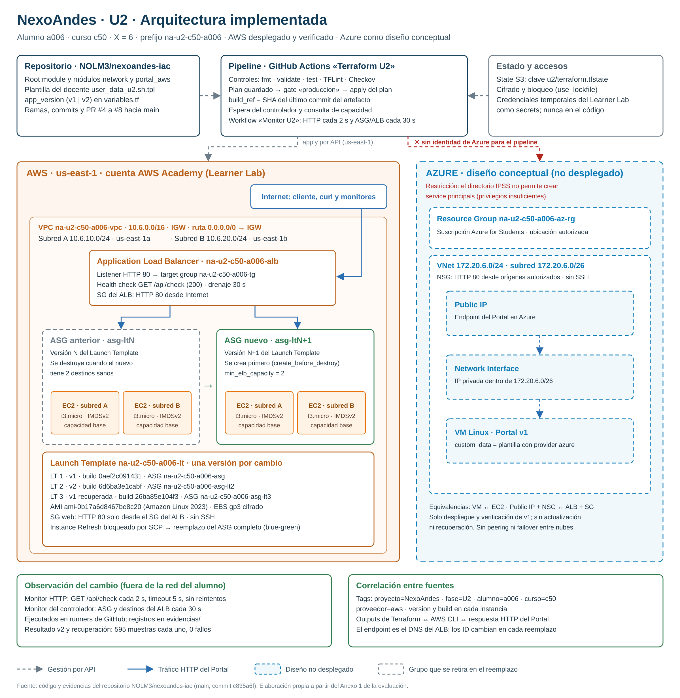

# NexoAndes — Portal Operacional (Fase 2: multi-cloud y actualización inmutable)

Infraestructura como código del Portal Operacional NexoAndes para la Evaluación Sumativa U2 de IC106TICL — Automatización de Infraestructura con IaC. Continúa el repositorio y el pipeline de la Fase 1 (U1).

- **Autor:** Martín López Speer
- **Identidad de laboratorio:** X = 6, alumno `a006`, curso `c50`, prefijo `na-u2-c50-a006`
- **Repositorio:** https://github.com/NOLM3/nexoandes-iac

## Arquitectura



**AWS (implementado, `us-east-1`):** VPC `10.6.0.0/16` con la subred A `10.6.10.0/24` (us-east-1a) y la subred B `10.6.20.0/24` (us-east-1b), Internet Gateway y ruta `0.0.0.0/0`. El tráfico entra por un Application Load Balancer (`na-u2-c50-a006-alb`, HTTP 80) que comprueba la salud de cada instancia en `/api/check`. Las instancias EC2 `t3.micro` las crea un Auto Scaling Group desde el Launch Template `na-u2-c50-a006-lt`: AMI fija de Amazon Linux 2023, IMDSv2 obligatorio, disco cifrado y la plantilla del docente como user data. Las instancias solo aceptan HTTP desde el security group del ALB y no tienen SSH.

**Azure (diseño conceptual, no desplegado):** VNet `172.20.6.0/24`, subred `172.20.6.0/26`, NSG con HTTP 80, IP pública, interfaz de red y VM Linux con el Portal v1. No se desplegó porque el directorio IPSS no permite crear el service principal que necesita el pipeline para autenticarse en Azure (ver Restricciones).

## Estructura del repositorio

```
.
├── .github/workflows/
│   ├── terraform.yml        # Pipeline: controles, plan, gate, apply y destroy
│   └── monitor.yml          # Monitores de la ventana de observación (ramas monitor/*)
├── modules/
│   ├── network/             # VPC, subredes, IGW, rutas y SG por defecto sin reglas
│   └── portal_aws/          # ALB, target group, security groups, Launch Template y ASG
├── templates/user_data_u2.sh.tpl   # Artefacto docente del Portal (v1/v2), sin modificar
├── tests/u2.tftest.hcl      # Pruebas con proveedor simulado
├── scripts/
│   ├── monitor_http.sh      # GET /api/check cada 2 s, timeout 5 s, sin reintentos
│   ├── monitor_asg.sh       # Instancias de los ASG y salud de destinos cada 30 s
│   └── analizar_http.py     # Resumen de un registro HTTP
├── docs/
│   ├── plan_cambio_v2.md    # Plan del cambio y de la recuperación, con la adaptación
│   ├── diagrama_u2.png      # Diagrama de la arquitectura implementada
│   └── README_ESTUDIANTE_U2.md   # Guía del docente para la plantilla
├── evidencias/              # Registros de verificación, observación y limpieza
├── backend.tf  locals.tf  main.tf  outputs.tf  provider.tf  variables.tf  versions.tf
├── .tflint.hcl
└── .terraform.lock.hcl
```

## Configuración

Los valores de la convención se calculan en `locals.tf` a partir de `x = 6` y `course = "c50"`: alumno, prefijo de nombres, redes y etiquetas (`proyecto`, `fase`, `alumno`, `curso`, `proveedor`). La plantilla del docente se renderiza con `templatefile()` y sus seis parámetros.

Variables principales en `variables.tf`:

- `app_version`: versión del Portal (`v1` o `v2`). Es el único valor que se cambia para actualizar o recuperar.
- `build_ref`: SHA del último commit que modificó el artefacto. Lo calcula el pipeline; no tiene valor por defecto.
- `ami_id`: AMI fija (`ami-0b17a6d8467be8c20`), para que una AMI nueva no reemplace instancias sin un cambio en el código.
- `base_capacity`: capacidad base del ASG (2).

Versiones: Terraform `>= 1.10.0` (pipeline con 1.16.6) y provider `hashicorp/aws` `>= 5.0, < 7.0` (6.69.1 en el lock file).

## Estrategia de actualización

Cada cambio de `app_version` crea una versión nueva del Launch Template. El nombre del ASG incluye esa versión, así que Terraform reemplaza el grupo completo con `create_before_destroy` (blue-green sobre el mismo ALB):

1. Crea el ASG nuevo con 2 instancias de la versión nueva, registradas en el mismo target group.
2. Espera a que las 2 estén sanas en el ALB (`min_elb_capacity = 2`).
3. Destruye el ASG anterior; el ALB drena sus instancias durante 30 s.

Las instancias nunca se modifican: siempre se reemplazan. La estrategia inicial era rolling con Instance Refresh, pero AWS Academy la bloquea con una service control policy. El detalle está en `docs/plan_cambio_v2.md`.

## Pipeline

`terraform.yml` se ejecuta en pull requests hacia `main`, en push a `main` y manualmente (`plan`, `apply` o `destroy`):

1. **Controles previos:** `terraform fmt -check`, `terraform validate`, `terraform test`, TFLint y Checkov. Sin credenciales.
2. **Plan:** calcula `build_ref`, genera el plan con el backend S3 y lo guarda como artefacto.
3. **Gate:** el environment `produccion` exige aprobación manual.
4. **Apply:** aplica exactamente el plan aprobado, muestra los outputs y registra las instancias y la salud de los destinos.
5. **Destroy:** manual, con plan de destrucción y la misma aprobación.

`monitor.yml` corre los monitores durante 20 minutos al subir una rama `monitor/<etiqueta>` y guarda los registros como artefactos:

```bash
git push origin <rama>:refs/heads/monitor/<etiqueta>
```

## Operación

- **Desplegar v1:** merge del PR con `app_version = "v1"` y aprobación del gate.
- **Actualizar a v2:** lanzar los monitores, esperar 2 minutos, merge del PR que cambia `app_version` a `"v2"` y aprobación del gate.
- **Recuperar v1:** el mismo procedimiento con `app_version = "v1"`. Crea instancias nuevas desde otra versión del Launch Template.
- **Verificar:** `terraform output`, AWS CLI y `curl http://<dns-del-alb>/api/check`.
- **Limpiar:** ejecución manual del pipeline con `destroy` y comprobación con AWS CLI.

## State y seguridad

- State en S3 (`nexoandes-tfstate-s6-943830680153`, clave `u2/terraform.tfstate`), cifrado y con bloqueo (`use_lockfile = true`).
- `.gitignore` excluye el state, los planes, `.terraform/`, los archivos de variables y las credenciales.
- El pipeline usa las credenciales temporales del Learner Lab como secrets del repositorio; el job de controles no las recibe.
- Sin SSH ni claves en el repositorio. Las omisiones de Checkov están justificadas en el código con `#checkov:skip`.

## Resultados (11-11-2026)

- **v1:** desplegado y verificado con outputs, AWS CLI y HTTP; plan posterior sin cambios.
- **v1 → v2:** el intento 1 fue rechazado por la SCP de AWS Academy y se conserva. En el intento 2 (blue-green) hubo 595 muestras HTTP, 0 fallos y al menos 2 destinos sanos en cada consulta.
- **Recuperación a v1:** 595 muestras, 0 fallos e instancias nuevas; plan posterior sin cambios.
- **Limpieza:** destroy de 19 recursos por pipeline y comprobación independiente sin recursos restantes.

Los registros están en `evidencias/` y el análisis completo en la ficha de evidencias U2.

## Restricciones

- **Azure:** `az ad sp create-for-rbac` responde «privilegios insuficientes» porque el directorio IPSS no permite crear service principals. Sin esa identidad, el pipeline no puede desplegar en Azure, que queda como diseño conceptual.
- **Instance Refresh:** AWS Academy deniega `autoscaling:StartInstanceRefresh` mediante una service control policy. Se reemplazó por blue-green con reemplazo del ASG.
- **Red del estudiante:** los timeouts del monitor local correspondían a la conexión móvil del cliente, por lo que el monitor principal corre en GitHub Actions.
